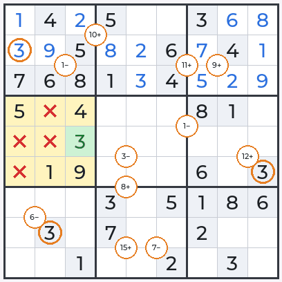

<!-- Written by tools/walkthrough.py mathrax: edit the script, not this page. -->
# Mathrax, step 15: the 3 in box 4

**Step 15 of 51** · [← Step 14](step-14.md) · [All steps](../mathrax.md#the-whole-puzzle-step-by-step) · [Step 16 →](step-16.md)

Box 4 needs a 3. r4c2 and r5c2: column 2 has one (r8c2). r5c1: column 1 has one (r2c1). r6c1: row 6 has one (r6c9). Only **r5c3** is left: **r5c3 = 3**.

**Step 15 of 51** · [← Step 14](step-14.md) · [All steps](../mathrax.md#the-whole-puzzle-step-by-step) · [Step 16 →](step-16.md)
