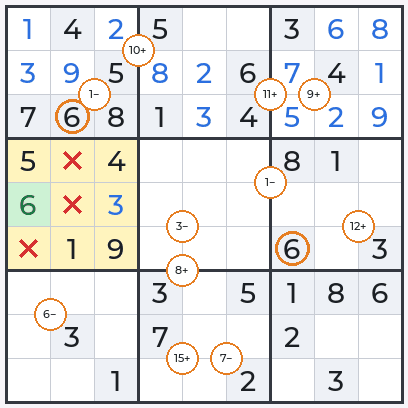

<!-- Written by tools/walkthrough.py mathrax: edit the script, not this page. -->
# Mathrax, step 16: the 6 in box 4

**Step 16 of 51** · [← Step 15](step-15.md) · [All steps](../mathrax.md#the-whole-puzzle-step-by-step) · [Step 17 →](step-17.md)

Box 4 needs a 6. r4c2 and r5c2: column 2 has one (r3c2). r6c1: row 6 has one (r6c7). Only **r5c1** is left: **r5c1 = 6**.

**Step 16 of 51** · [← Step 15](step-15.md) · [All steps](../mathrax.md#the-whole-puzzle-step-by-step) · [Step 17 →](step-17.md)
