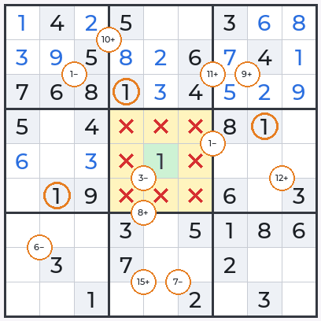

<!-- Written by tools/walkthrough.py mathrax: edit the script, not this page. -->
# Mathrax, step 17: the 1 in box 5

**Step 17 of 51** · [← Step 16](step-16.md) · [All steps](../mathrax.md#the-whole-puzzle-step-by-step) · [Step 18 →](step-18.md)

Box 5 needs a 1. r4c4, r4c5 and r4c6: row 4 has one (r4c8). r5c4: column 4 has one (r3c4). r6c4, r6c5 and r6c6: row 6 has one (r6c2). r5c6: across the 1− circle from the 8 in r4c7: 1 and 8 aren't 1 apart. Only **r5c5** is left: **r5c5 = 1**.

**Step 17 of 51** · [← Step 16](step-16.md) · [All steps](../mathrax.md#the-whole-puzzle-step-by-step) · [Step 18 →](step-18.md)
