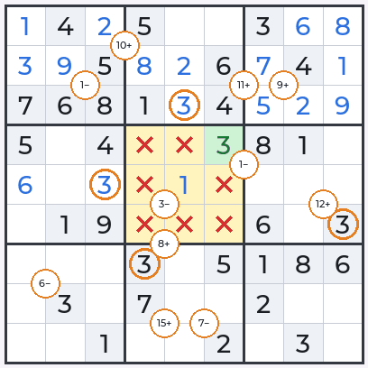

<!-- Written by tools/walkthrough.py mathrax: edit the script, not this page. -->
# Mathrax, step 18: the 3 in box 5

**Step 18 of 51** · [← Step 17](step-17.md) · [All steps](../mathrax.md#the-whole-puzzle-step-by-step) · [Step 19 →](step-19.md)

Box 5 needs a 3. r4c4: column 4 has one (r7c4). r4c5: column 5 has one (r3c5). r5c4 and r5c6: row 5 has one (r5c3). r6c4, r6c5 and r6c6: row 6 has one (r6c9). Only **r4c6** is left: **r4c6 = 3**.

**Step 18 of 51** · [← Step 17](step-17.md) · [All steps](../mathrax.md#the-whole-puzzle-step-by-step) · [Step 19 →](step-19.md)
