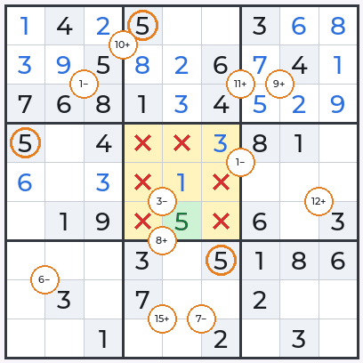

<!-- Written by tools/walkthrough.py mathrax: edit the script, not this page. -->
# Mathrax, step 19: the 5 in box 5

**Step 19 of 51** · [← Step 18](step-18.md) · [All steps](../mathrax.md#the-whole-puzzle-step-by-step) · [Step 20 →](step-20.md)

Box 5 needs a 5. r4c4 and r4c5: row 4 has one (r4c1). r5c4 and r6c4: column 4 has one (r1c4). r5c6 and r6c6: column 6 has one (r7c6). Only **r6c5** is left: **r6c5 = 5**.

**Step 19 of 51** · [← Step 18](step-18.md) · [All steps](../mathrax.md#the-whole-puzzle-step-by-step) · [Step 20 →](step-20.md)
