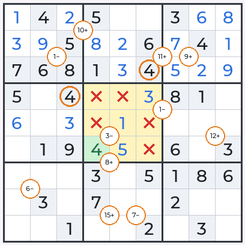

<!-- Written by tools/walkthrough.py mathrax: edit the script, not this page. -->
# Mathrax, step 20: the 4 in box 5

**Step 20 of 51** · [← Step 19](step-19.md) · [All steps](../mathrax.md#the-whole-puzzle-step-by-step) · [Step 21 →](step-21.md)

Box 5 needs a 4. r4c4 and r4c5: row 4 has one (r4c3). r5c6 and r6c6: column 6 has one (r3c6). r5c4: across the 3− circle from the 5 in r6c5: 4 and 5 aren't 3 apart. Only **r6c4** is left: **r6c4 = 4**.

**Step 20 of 51** · [← Step 19](step-19.md) · [All steps](../mathrax.md#the-whole-puzzle-step-by-step) · [Step 21 →](step-21.md)
