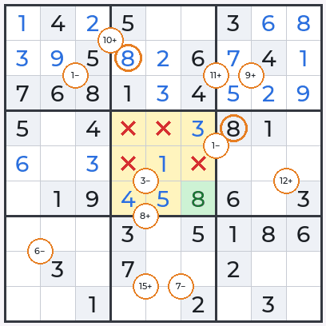

<!-- Written by tools/walkthrough.py mathrax: edit the script, not this page. -->
# Mathrax, step 21: the 8 in box 5

**Step 21 of 51** · [← Step 20](step-20.md) · [All steps](../mathrax.md#the-whole-puzzle-step-by-step) · [Step 22 →](step-22.md)

Box 5 needs an 8. r4c4 and r4c5: row 4 has one (r4c7). r5c4: column 4 has one (r2c4). r5c6: across the 1− circle from the 8 in r4c7: 8 and 8 aren't 1 apart. Only **r6c6** is left: **r6c6 = 8**.

**Step 21 of 51** · [← Step 20](step-20.md) · [All steps](../mathrax.md#the-whole-puzzle-step-by-step) · [Step 22 →](step-22.md)
