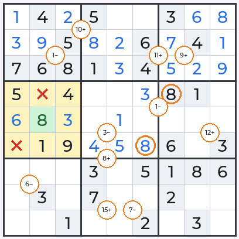

<!-- Written by tools/walkthrough.py mathrax: edit the script, not this page. -->
# Mathrax, step 22: the 8 in box 4

**Step 22 of 51** · [← Step 21](step-21.md) · [All steps](../mathrax.md#the-whole-puzzle-step-by-step) · [Step 23 →](step-23.md)

Box 4 needs an 8. r4c2: row 4 has one (r4c7). r6c1: row 6 has one (r6c6). Only **r5c2** is left: **r5c2 = 8**.

**Step 22 of 51** · [← Step 21](step-21.md) · [All steps](../mathrax.md#the-whole-puzzle-step-by-step) · [Step 23 →](step-23.md)
