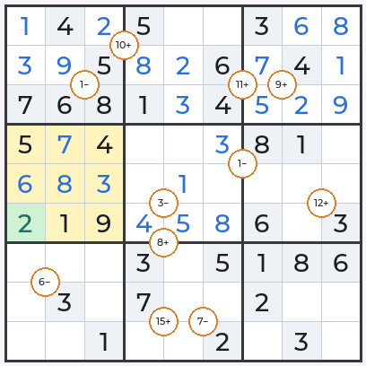

<!-- Written by tools/walkthrough.py mathrax: edit the script, not this page. -->
# Mathrax, step 24: the 2 in box 4

**Step 24 of 51** · [← Step 23](step-23.md) · [All steps](../mathrax.md#the-whole-puzzle-step-by-step) · [Step 25 →](step-25.md)

Box 4 needs a 2, and r6c1 is its last empty cell: **r6c1 = 2**.

**Step 24 of 51** · [← Step 23](step-23.md) · [All steps](../mathrax.md#the-whole-puzzle-step-by-step) · [Step 25 →](step-25.md)
