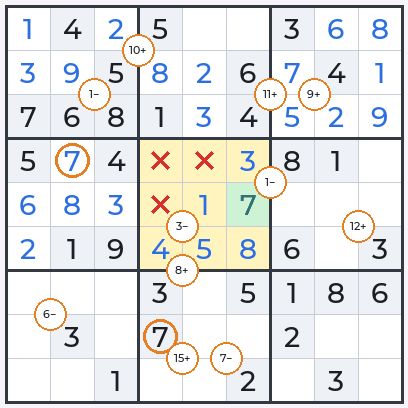

<!-- Written by tools/walkthrough.py mathrax: edit the script, not this page. -->
# Mathrax, step 25: the 7 in box 5

**Step 25 of 51** · [← Step 24](step-24.md) · [All steps](../mathrax.md#the-whole-puzzle-step-by-step) · [Step 26 →](step-26.md)

Box 5 needs a 7. r4c4 and r4c5: row 4 has one (r4c2). r5c4: column 4 has one (r8c4). Only **r5c6** is left: **r5c6 = 7**.

**Step 25 of 51** · [← Step 24](step-24.md) · [All steps](../mathrax.md#the-whole-puzzle-step-by-step) · [Step 26 →](step-26.md)
