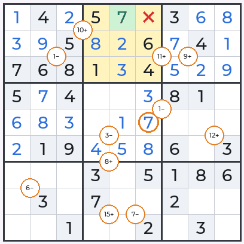

<!-- Written by tools/walkthrough.py mathrax: edit the script, not this page. -->
# Mathrax, step 26: the 7 in box 2

**Step 26 of 51** · [← Step 25](step-25.md) · [All steps](../mathrax.md#the-whole-puzzle-step-by-step) · [Step 27 →](step-27.md)

Box 2 needs a 7. r1c6: column 6 has one (r5c6). Only **r1c5** is left: **r1c5 = 7**.

**Step 26 of 51** · [← Step 25](step-25.md) · [All steps](../mathrax.md#the-whole-puzzle-step-by-step) · [Step 27 →](step-27.md)
