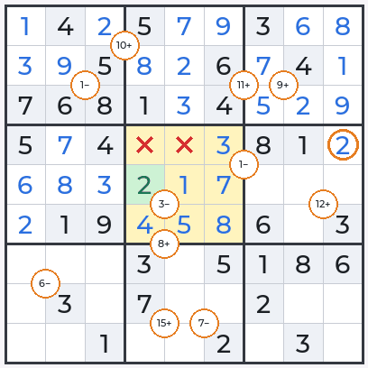

<!-- Written by tools/walkthrough.py mathrax: edit the script, not this page. -->
# Mathrax, step 29: the 2 in box 5

**Step 29 of 51** · [← Step 28](step-28.md) · [All steps](../mathrax.md#the-whole-puzzle-step-by-step) · [Step 30 →](step-30.md)

Box 5 needs a 2. r4c4 and r4c5: row 4 has one (r4c9). Only **r5c4** is left: **r5c4 = 2**.

**Step 29 of 51** · [← Step 28](step-28.md) · [All steps](../mathrax.md#the-whole-puzzle-step-by-step) · [Step 30 →](step-30.md)
