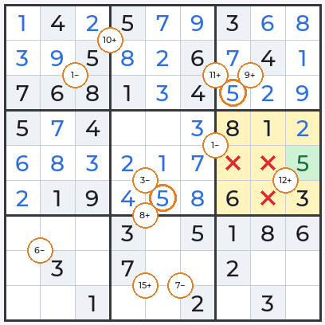

<!-- Written by tools/walkthrough.py mathrax: edit the script, not this page. -->
# Mathrax, step 30: the 5 in box 6

**Step 30 of 51** · [← Step 29](step-29.md) · [All steps](../mathrax.md#the-whole-puzzle-step-by-step) · [Step 31 →](step-31.md)

Box 6 needs a 5. r5c7: column 7 has one (r3c7). r6c8: row 6 has one (r6c5). r5c8: across the 12+ circle from the 3 in r6c9: 5 and 3 don't add up to 12. Only **r5c9** is left: **r5c9 = 5**.

**Step 30 of 51** · [← Step 29](step-29.md) · [All steps](../mathrax.md#the-whole-puzzle-step-by-step) · [Step 31 →](step-31.md)
