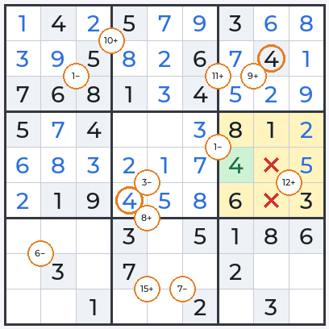

<!-- Written by tools/walkthrough.py mathrax: edit the script, not this page. -->
# Mathrax, step 31: the 4 in box 6

**Step 31 of 51** · [← Step 30](step-30.md) · [All steps](../mathrax.md#the-whole-puzzle-step-by-step) · [Step 32 →](step-32.md)

Box 6 needs a 4. r5c8: column 8 has one (r2c8). r6c8: row 6 has one (r6c4). Only **r5c7** is left: **r5c7 = 4**.

**Step 31 of 51** · [← Step 30](step-30.md) · [All steps](../mathrax.md#the-whole-puzzle-step-by-step) · [Step 32 →](step-32.md)
