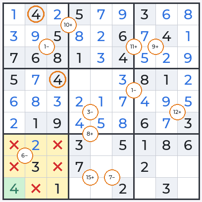

<!-- Written by tools/walkthrough.py mathrax: edit the script, not this page. -->
# Mathrax, step 35: the 4 in box 7

**Step 35 of 51** · [← Step 34](step-34.md) · [All steps](../mathrax.md#the-whole-puzzle-step-by-step) · [Step 36 →](step-36.md)

Box 7 needs a 4. r7c3 and r8c3: column 3 has one (r4c3). r9c2: column 2 has one (r1c2). r7c1: across the 6− circle from the 3 in r8c2: 4 and 3 aren't 6 apart. r8c1: across the 6− circle from the 2 in r7c2: 4 and 2 aren't 6 apart. Only **r9c1** is left: **r9c1 = 4**.

**Step 35 of 51** · [← Step 34](step-34.md) · [All steps](../mathrax.md#the-whole-puzzle-step-by-step) · [Step 36 →](step-36.md)
