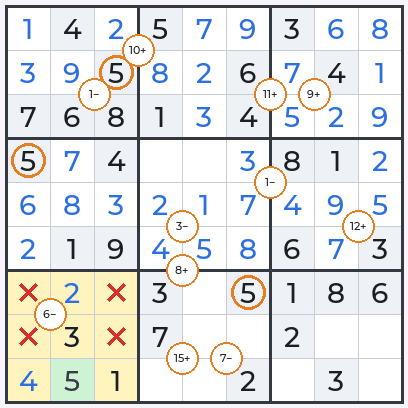

<!-- Written by tools/walkthrough.py mathrax: edit the script, not this page. -->
# Mathrax, step 36: the 5 in box 7

**Step 36 of 51** · [← Step 35](step-35.md) · [All steps](../mathrax.md#the-whole-puzzle-step-by-step) · [Step 37 →](step-37.md)

Box 7 needs a 5. r7c1 and r7c3: row 7 has one (r7c6). r8c1: column 1 has one (r4c1). r8c3: column 3 has one (r2c3). Only **r9c2** is left: **r9c2 = 5**.

**Step 36 of 51** · [← Step 35](step-35.md) · [All steps](../mathrax.md#the-whole-puzzle-step-by-step) · [Step 37 →](step-37.md)
