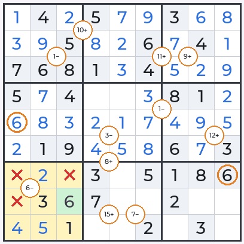

<!-- Written by tools/walkthrough.py mathrax: edit the script, not this page. -->
# Mathrax, step 37: the 6 in box 7

**Step 37 of 51** · [← Step 36](step-36.md) · [All steps](../mathrax.md#the-whole-puzzle-step-by-step) · [Step 38 →](step-38.md)

Box 7 needs a 6. r7c1 and r7c3: row 7 has one (r7c9). r8c1: column 1 has one (r5c1). Only **r8c3** is left: **r8c3 = 6**.

**Step 37 of 51** · [← Step 36](step-36.md) · [All steps](../mathrax.md#the-whole-puzzle-step-by-step) · [Step 38 →](step-38.md)
