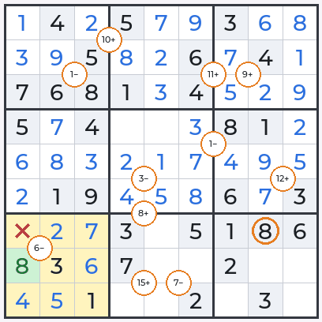

<!-- Written by tools/walkthrough.py mathrax: edit the script, not this page. -->
# Mathrax, step 39: the 8 in box 7

**Step 39 of 51** · [← Step 38](step-38.md) · [All steps](../mathrax.md#the-whole-puzzle-step-by-step) · [Step 40 →](step-40.md)

Box 7 needs an 8. r7c1: row 7 has one (r7c8). Only **r8c1** is left: **r8c1 = 8**.

**Step 39 of 51** · [← Step 38](step-38.md) · [All steps](../mathrax.md#the-whole-puzzle-step-by-step) · [Step 40 →](step-40.md)
