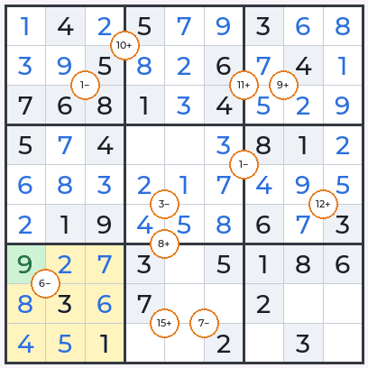

<!-- Written by tools/walkthrough.py mathrax: edit the script, not this page. -->
# Mathrax, step 40: the 9 in box 7

**Step 40 of 51** · [← Step 39](step-39.md) · [All steps](../mathrax.md#the-whole-puzzle-step-by-step) · [Step 41 →](step-41.md)

Box 7 needs a 9, and r7c1 is its last empty cell: **r7c1 = 9**.

**Step 40 of 51** · [← Step 39](step-39.md) · [All steps](../mathrax.md#the-whole-puzzle-step-by-step) · [Step 41 →](step-41.md)
