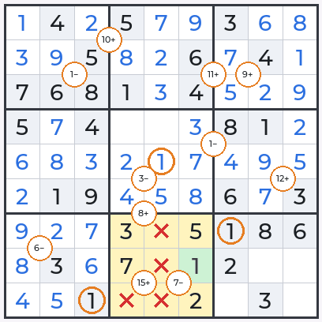

<!-- Written by tools/walkthrough.py mathrax: edit the script, not this page. -->
# Mathrax, step 41: the 1 in box 8

**Step 41 of 51** · [← Step 40](step-40.md) · [All steps](../mathrax.md#the-whole-puzzle-step-by-step) · [Step 42 →](step-42.md)

Box 8 needs a 1. r7c5: row 7 has one (r7c7). r8c5: column 5 has one (r5c5). r9c4 and r9c5: row 9 has one (r9c3). Only **r8c6** is left: **r8c6 = 1**.

**Step 41 of 51** · [← Step 40](step-40.md) · [All steps](../mathrax.md#the-whole-puzzle-step-by-step) · [Step 42 →](step-42.md)
