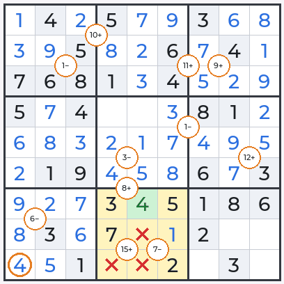

<!-- Written by tools/walkthrough.py mathrax: edit the script, not this page. -->
# Mathrax, step 42: the 4 in box 8

**Step 42 of 51** · [← Step 41](step-41.md) · [All steps](../mathrax.md#the-whole-puzzle-step-by-step) · [Step 43 →](step-43.md)

Box 8 needs a 4. r9c4 and r9c5: row 9 has one (r9c1). r8c5: across the 7− circle from the 2 in r9c6: 4 and 2 aren't 7 apart. Only **r7c5** is left: **r7c5 = 4**.

**Step 42 of 51** · [← Step 41](step-41.md) · [All steps](../mathrax.md#the-whole-puzzle-step-by-step) · [Step 43 →](step-43.md)
