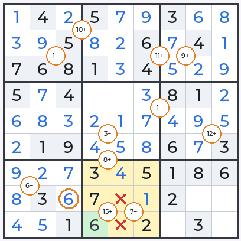

<!-- Written by tools/walkthrough.py mathrax: edit the script, not this page. -->
# Mathrax, step 43: the 6 in box 8

**Step 43 of 51** · [← Step 42](step-42.md) · [All steps](../mathrax.md#the-whole-puzzle-step-by-step) · [Step 44 →](step-44.md)

Box 8 needs a 6. r8c5: row 8 has one (r8c3). r9c5: across the 7− circle from the 1 in r8c6: 6 and 1 aren't 7 apart. Only **r9c4** is left: **r9c4 = 6**.

**Step 43 of 51** · [← Step 42](step-42.md) · [All steps](../mathrax.md#the-whole-puzzle-step-by-step) · [Step 44 →](step-44.md)
