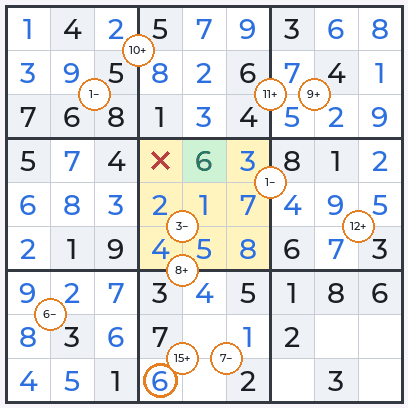

<!-- Written by tools/walkthrough.py mathrax: edit the script, not this page. -->
# Mathrax, step 44: the 6 in box 5

**Step 44 of 51** · [← Step 43](step-43.md) · [All steps](../mathrax.md#the-whole-puzzle-step-by-step) · [Step 45 →](step-45.md)

Box 5 needs a 6. r4c4: column 4 has one (r9c4). Only **r4c5** is left: **r4c5 = 6**.

**Step 44 of 51** · [← Step 43](step-43.md) · [All steps](../mathrax.md#the-whole-puzzle-step-by-step) · [Step 45 →](step-45.md)
