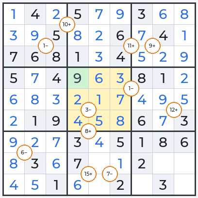

<!-- Written by tools/walkthrough.py mathrax: edit the script, not this page. -->
# Mathrax, step 45: the 9 in box 5

**Step 45 of 51** · [← Step 44](step-44.md) · [All steps](../mathrax.md#the-whole-puzzle-step-by-step) · [Step 46 →](step-46.md)

Box 5 needs a 9, and r4c4 is its last empty cell: **r4c4 = 9**.

**Step 45 of 51** · [← Step 44](step-44.md) · [All steps](../mathrax.md#the-whole-puzzle-step-by-step) · [Step 46 →](step-46.md)
