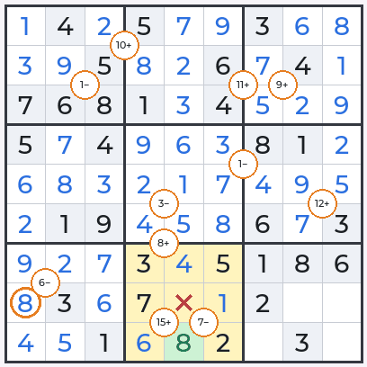

<!-- Written by tools/walkthrough.py mathrax: edit the script, not this page. -->
# Mathrax, step 46: the 8 in box 8

**Step 46 of 51** · [← Step 45](step-45.md) · [All steps](../mathrax.md#the-whole-puzzle-step-by-step) · [Step 47 →](step-47.md)

Box 8 needs an 8. r8c5: row 8 has one (r8c1). Only **r9c5** is left: **r9c5 = 8**.

**Step 46 of 51** · [← Step 45](step-45.md) · [All steps](../mathrax.md#the-whole-puzzle-step-by-step) · [Step 47 →](step-47.md)
