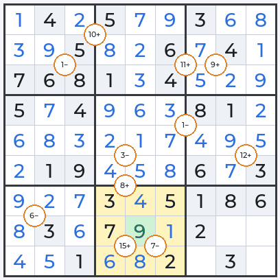

<!-- Written by tools/walkthrough.py mathrax: edit the script, not this page. -->
# Mathrax, step 47: the 9 in box 8

**Step 47 of 51** · [← Step 46](step-46.md) · [All steps](../mathrax.md#the-whole-puzzle-step-by-step) · [Step 48 →](step-48.md)

Box 8 needs a 9, and r8c5 is its last empty cell: **r8c5 = 9**.

**Step 47 of 51** · [← Step 46](step-46.md) · [All steps](../mathrax.md#the-whole-puzzle-step-by-step) · [Step 48 →](step-48.md)
