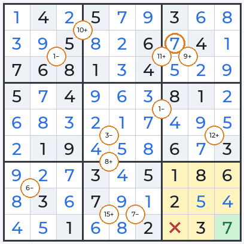

<!-- Written by tools/walkthrough.py mathrax: edit the script, not this page. -->
# Mathrax, step 50: the 7 in box 9

**Step 50 of 51** · [← Step 49](step-49.md) · [All steps](../mathrax.md#the-whole-puzzle-step-by-step) · [Step 51 →](step-51.md)

Box 9 needs a 7. r9c7: column 7 has one (r2c7). Only **r9c9** is left: **r9c9 = 7**.

**Step 50 of 51** · [← Step 49](step-49.md) · [All steps](../mathrax.md#the-whole-puzzle-step-by-step) · [Step 51 →](step-51.md)
