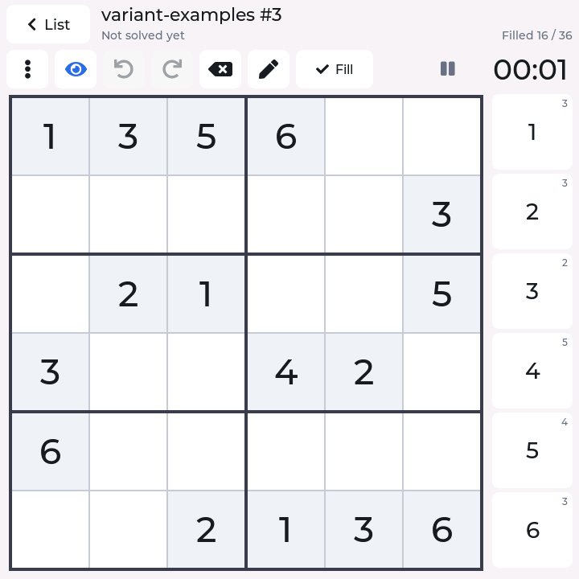
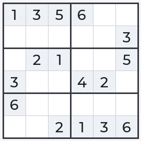

# Mini 6×6

[← All variants](README.md) · [Puzzles](../features-puzzles.md) · [How to play](../how-to-play.md)

## The rules

A 6×6 grid with the digits 1 to 6: every **row**, every **column** and every **box** holds 1 to 6, each once. The boxes are **2 rows tall and 3 columns wide**, so there are six of them: two side by side, three down.

## On the board

- Bigger cells and a six-key number pad; everything else works as in [Classic](classic.md).
- **Puzzles → ⋮ → New puzzle → Mini 6x6**, at all four levels; it's also Tuesday's daily puzzle. Easy keeps 16 or more of the 36 cells.
- A good size for a quick game, or to learn the techniques on a smaller board.

## How to solve it

- The same steps as Classic, with fewer cells to scan: look for **hidden singles** in each box and line first.
- Mind the box shape: a box spans 3 columns but only 2 rows. A digit placed in a row rules out the whole width of a box, but only half of its height.
- Hard Mini puzzles need **pairs** or **pointing**, as in Classic; they're rarer here, so Hard takes longer to make (about a second on the board).

## Worked example

**variant-examples #3**, Mini 6×6 Easy (see [Classic](classic.md#worked-example-the-whole-puzzle) for how to import the examples; cells are written r*row*c*column*).

**Step 1: the 2 in box 1 (rows 1–2, columns 1–3).** Row 1 of the box is full (1, 3, 5), so the 2 goes in row 2: r2c1, r2c2 or r2c3. Column 2 has a 2 (r3c2), and so does column 3 (r6c3). **r2c1 = 2**.

**Step 2: the 1 in box 2 (rows 1–2, columns 4–6).** Its empty cells are r1c5, r1c6, r2c4 and r2c5. Row 1 has a 1 (r1c1), which rules out r1c5 and r1c6; column 4 has a 1 (r6c4), which rules out r2c4. **r2c5 = 1**.

**Step 3: the 2 in box 2.** Left empty: r1c5, r1c6 and r2c4. Column 5 has a 2 (r4c5), and row 2 now has the 2 from step 1 (r2c1). **r1c6 = 2**.

Box 2 then has two cells left, r1c5 and r2c4, for 4 and 5; row 1 already has a 5 (r1c3), so r1c5 = 4 and r2c4 = 5. The rest of the grid follows the same way.

## The whole puzzle, step by step

<!-- walkthrough -->
<!-- Written by tools/walkthrough.py mini-6x6: edit the script, not this part. -->

The whole puzzle, from the start to the last cell: 20 steps, each one a single (one place left for a digit, or one digit left for a cell), taken in the order a box's single comes first, so not quite the order of the worked example above. Each step has a page of its own, with **Previous** and **Next**: pick its number below. In each picture, the unit the step looks at is tinted yellow (for a cell with one digit left: its row, column and box), the new digit is on green, the digits that rule cells out have an **orange ring**, and the empty cells they rule out a **red cross**. Givens are on grey, digits from earlier steps in blue.

| [1](mini-6x6/step-01.md) | [2](mini-6x6/step-02.md) | [3](mini-6x6/step-03.md) | [4](mini-6x6/step-04.md) | [5](mini-6x6/step-05.md) | [6](mini-6x6/step-06.md) | [7](mini-6x6/step-07.md) | [8](mini-6x6/step-08.md) | [9](mini-6x6/step-09.md) | [10](mini-6x6/step-10.md) |
|:-:|:-:|:-:|:-:|:-:|:-:|:-:|:-:|:-:|:-:|
| [11](mini-6x6/step-11.md) | [12](mini-6x6/step-12.md) | [13](mini-6x6/step-13.md) | [14](mini-6x6/step-14.md) | [15](mini-6x6/step-15.md) | [16](mini-6x6/step-16.md) | [17](mini-6x6/step-17.md) | [18](mini-6x6/step-18.md) | [19](mini-6x6/step-19.md) | [20](mini-6x6/step-20.md) |

Solved.

<!-- /walkthrough -->
