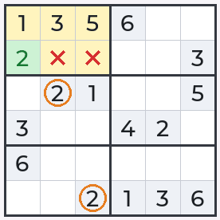
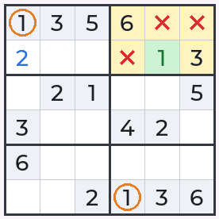
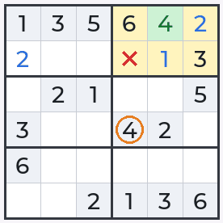
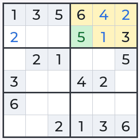
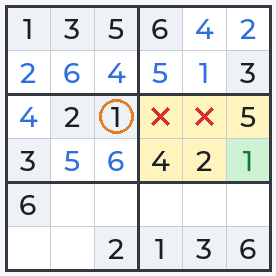
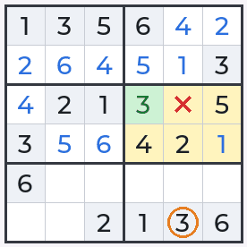
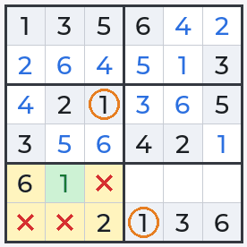
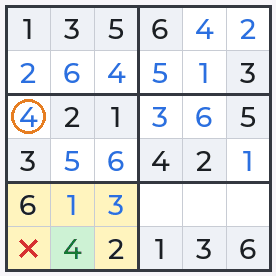
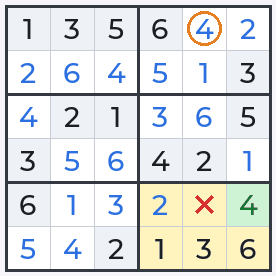
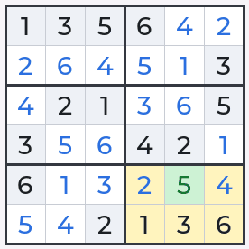

# Mini 6×6

[← All variants](README.md) · [Puzzles](../features-puzzles.md) · [How to play](../how-to-play.md)


## The rules

A 6×6 grid with the digits 1 to 6: every **row**, every **column** and every **box** holds 1 to 6, each once. The boxes are **2 rows tall and 3 columns wide**, so there are six of them: two side by side, three down.

## On the board

- Bigger cells and a six-key number pad; everything else works as in [Classic](classic.md).
- **Puzzles → ⋮ → New puzzle → Mini 6x6**, at all four levels; it's also Tuesday's daily puzzle. Easy keeps 16 or more of the 36 cells.
- A good size for a quick game, or to learn the techniques on a smaller board.

## How to solve it

- The same steps as Classic, with fewer cells to scan: look for **hidden singles** in each box and line first.
- Mind the box shape: a box spans 3 columns but only 2 rows. A digit placed in a row rules out the whole width of a box, but only half of its height.
- Hard Mini puzzles need **pairs** or **pointing**, as in Classic; they're rarer here, so Hard takes longer to make (about a second on the board).

## Worked example

**variant-examples #3**, Mini 6×6 Easy (see [Classic](classic.md#worked-example) for how to import the examples; cells are written r*row*c*column*).

```
1 3 5 | 6 . .
. . . | . . 3
------+------
. 2 1 | . . 5
3 . . | 4 2 .
------+------
6 . . | . . .
. . 2 | 1 3 6
```

**Step 1: the 2 in box 1 (rows 1–2, columns 1–3).** Row 1 of the box is full (1, 3, 5), so the 2 goes in row 2: r2c1, r2c2 or r2c3. Column 2 has a 2 (r3c2), and so does column 3 (r6c3). **r2c1 = 2**.

**Step 2: the 1 in box 2 (rows 1–2, columns 4–6).** Its empty cells are r1c5, r1c6, r2c4 and r2c5. Row 1 has a 1 (r1c1), which rules out r1c5 and r1c6; column 4 has a 1 (r6c4), which rules out r2c4. **r2c5 = 1**.

**Step 3: the 2 in box 2.** Left empty: r1c5, r1c6 and r2c4. Column 5 has a 2 (r4c5), and row 2 now has the 2 from step 1 (r2c1). **r1c6 = 2**.

Box 2 then has two cells left, r1c5 and r2c4, for 4 and 5; row 1 already has a 5 (r1c3), so r1c5 = 4 and r2c4 = 5. The rest of the grid follows the same way.

## The whole puzzle, step by step

<!-- walkthrough -->
<!-- Written by tools/walkthrough.py mini-6x6: edit the script, not this part. -->

The whole puzzle, from the start to the last cell: 20 steps, each one a single (one place left for a digit, or one digit left for a cell), taken in the order a box's single comes first, so not quite the order of the worked example above. In each picture, the unit the step looks at is tinted yellow (for a cell with one digit left: its row, column and box), the new digit is on green, the digits that rule cells out have an **orange ring**, and the empty cells they rule out a **red cross**. Givens are on grey, digits from earlier steps in blue.


#### Step 1: the 2 in box 1

Box 1 needs a 2. r2c2: column 2 has one (r3c2). r2c3: column 3 has one (r6c3). Only **r2c1** is left: **r2c1 = 2**.



#### Step 2: the 1 in box 2

Box 2 needs a 1. r1c5 and r1c6: row 1 has one (r1c1). r2c4: column 4 has one (r6c4). Only **r2c5** is left: **r2c5 = 1**.



#### Step 3: the 2 in box 2

Box 2 needs a 2. r1c5: column 5 has one (r4c5). r2c4: row 2 has one (r2c1). Only **r1c6** is left: **r1c6 = 2**.


#### Step 4: the 4 in box 2

Box 2 needs a 4. r2c4: column 4 has one (r4c4). Only **r1c5** is left: **r1c5 = 4**.



#### Step 5: the 5 in box 2

Box 2 needs a 5, and r2c4 is its last empty cell: **r2c4 = 5**.



#### Step 6: the 4 in box 3

Box 3 needs a 4. r4c2 and r4c3: row 4 has one (r4c4). Only **r3c1** is left: **r3c1 = 4**.


#### Step 7: the 5 in box 3

Box 3 needs a 5. r4c3: column 3 has one (r1c3). Only **r4c2** is left: **r4c2 = 5**.


#### Step 8: the 6 in box 3

Box 3 needs a 6, and r4c3 is its last empty cell: **r4c3 = 6**.


#### Step 9: the 6 in box 1

Box 1 needs a 6. r2c3: column 3 has one (r4c3). Only **r2c2** is left: **r2c2 = 6**.


#### Step 10: the 4 in box 1

Box 1 needs a 4, and r2c3 is its last empty cell: **r2c3 = 4**.


#### Step 11: the 1 in box 4

Box 4 needs a 1. r3c4 and r3c5: row 3 has one (r3c3). Only **r4c6** is left: **r4c6 = 1**.



#### Step 12: the 3 in box 4

Box 4 needs a 3. r3c5: column 5 has one (r6c5). Only **r3c4** is left: **r3c4 = 3**.



#### Step 13: the 6 in box 4

Box 4 needs a 6, and r3c5 is its last empty cell: **r3c5 = 6**.


#### Step 14: the 1 in box 5

Box 5 needs a 1. r5c3: column 3 has one (r3c3). r6c1 and r6c2: row 6 has one (r6c4). Only **r5c2** is left: **r5c2 = 1**.



#### Step 15: the 3 in box 5

Box 5 needs a 3. r6c1 and r6c2: row 6 has one (r6c5). Only **r5c3** is left: **r5c3 = 3**.


#### Step 16: the 4 in box 5

Box 5 needs a 4. r6c1: column 1 has one (r3c1). Only **r6c2** is left: **r6c2 = 4**.



#### Step 17: the 5 in box 5

Box 5 needs a 5, and r6c1 is its last empty cell: **r6c1 = 5**.


#### Step 18: the 2 in box 6

Box 6 needs a 2. r5c5: column 5 has one (r4c5). r5c6: column 6 has one (r1c6). Only **r5c4** is left: **r5c4 = 2**.


#### Step 19: the 4 in box 6

Box 6 needs a 4. r5c5: column 5 has one (r1c5). Only **r5c6** is left: **r5c6 = 4**.



#### Step 20: the 5 in box 6

Box 6 needs a 5, and r5c5 is its last empty cell: **r5c5 = 5**.



Solved.

<!-- /walkthrough -->
