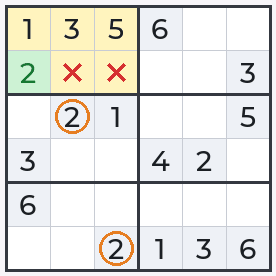

<!-- Written by tools/walkthrough.py mini-6x6: edit the script, not this page. -->
# Mini 6x6, step 1: the 2 in box 1

**Step 1 of 20** · [← The start](../mini-6x6.md#the-whole-puzzle-step-by-step) · [All steps](../mini-6x6.md#the-whole-puzzle-step-by-step) · [Step 2 →](step-02.md)

Box 1 needs a 2. r2c2: column 2 has one (r3c2). r2c3: column 3 has one (r6c3). Only **r2c1** is left: **r2c1 = 2**.

**Step 1 of 20** · [← The start](../mini-6x6.md#the-whole-puzzle-step-by-step) · [All steps](../mini-6x6.md#the-whole-puzzle-step-by-step) · [Step 2 →](step-02.md)
