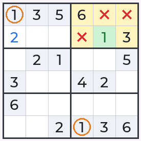

<!-- Written by tools/walkthrough.py mini-6x6: edit the script, not this page. -->
# Mini 6x6, step 2: the 1 in box 2

**Step 2 of 20** · [← Step 1](step-01.md) · [All steps](../mini-6x6.md#the-whole-puzzle-step-by-step) · [Step 3 →](step-03.md)

Box 2 needs a 1. r1c5 and r1c6: row 1 has one (r1c1). r2c4: column 4 has one (r6c4). Only **r2c5** is left: **r2c5 = 1**.

**Step 2 of 20** · [← Step 1](step-01.md) · [All steps](../mini-6x6.md#the-whole-puzzle-step-by-step) · [Step 3 →](step-03.md)
