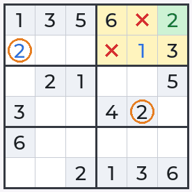

<!-- Written by tools/walkthrough.py mini-6x6: edit the script, not this page. -->
# Mini 6x6, step 3: the 2 in box 2

**Step 3 of 20** · [← Step 2](step-02.md) · [All steps](../mini-6x6.md#the-whole-puzzle-step-by-step) · [Step 4 →](step-04.md)

Box 2 needs a 2. r1c5: column 5 has one (r4c5). r2c4: row 2 has one (r2c1). Only **r1c6** is left: **r1c6 = 2**.

**Step 3 of 20** · [← Step 2](step-02.md) · [All steps](../mini-6x6.md#the-whole-puzzle-step-by-step) · [Step 4 →](step-04.md)
