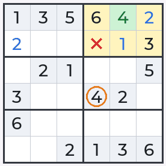

<!-- Written by tools/walkthrough.py mini-6x6: edit the script, not this page. -->
# Mini 6x6, step 4: the 4 in box 2

**Step 4 of 20** · [← Step 3](step-03.md) · [All steps](../mini-6x6.md#the-whole-puzzle-step-by-step) · [Step 5 →](step-05.md)

Box 2 needs a 4. r2c4: column 4 has one (r4c4). Only **r1c5** is left: **r1c5 = 4**.

**Step 4 of 20** · [← Step 3](step-03.md) · [All steps](../mini-6x6.md#the-whole-puzzle-step-by-step) · [Step 5 →](step-05.md)
