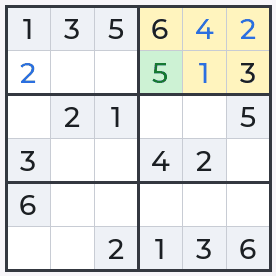

<!-- Written by tools/walkthrough.py mini-6x6: edit the script, not this page. -->
# Mini 6x6, step 5: the 5 in box 2

**Step 5 of 20** · [← Step 4](step-04.md) · [All steps](../mini-6x6.md#the-whole-puzzle-step-by-step) · [Step 6 →](step-06.md)

Box 2 needs a 5, and r2c4 is its last empty cell: **r2c4 = 5**.

**Step 5 of 20** · [← Step 4](step-04.md) · [All steps](../mini-6x6.md#the-whole-puzzle-step-by-step) · [Step 6 →](step-06.md)
