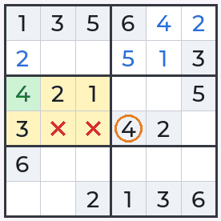

<!-- Written by tools/walkthrough.py mini-6x6: edit the script, not this page. -->
# Mini 6x6, step 6: the 4 in box 3

**Step 6 of 20** · [← Step 5](step-05.md) · [All steps](../mini-6x6.md#the-whole-puzzle-step-by-step) · [Step 7 →](step-07.md)

Box 3 needs a 4. r4c2 and r4c3: row 4 has one (r4c4). Only **r3c1** is left: **r3c1 = 4**.

**Step 6 of 20** · [← Step 5](step-05.md) · [All steps](../mini-6x6.md#the-whole-puzzle-step-by-step) · [Step 7 →](step-07.md)
