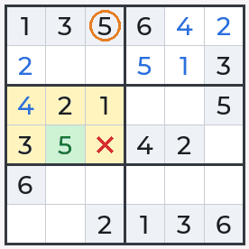

<!-- Written by tools/walkthrough.py mini-6x6: edit the script, not this page. -->
# Mini 6x6, step 7: the 5 in box 3

**Step 7 of 20** · [← Step 6](step-06.md) · [All steps](../mini-6x6.md#the-whole-puzzle-step-by-step) · [Step 8 →](step-08.md)

Box 3 needs a 5. r4c3: column 3 has one (r1c3). Only **r4c2** is left: **r4c2 = 5**.

**Step 7 of 20** · [← Step 6](step-06.md) · [All steps](../mini-6x6.md#the-whole-puzzle-step-by-step) · [Step 8 →](step-08.md)
