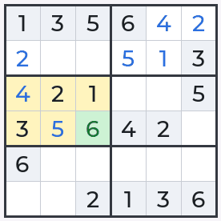

<!-- Written by tools/walkthrough.py mini-6x6: edit the script, not this page. -->
# Mini 6x6, step 8: the 6 in box 3

**Step 8 of 20** · [← Step 7](step-07.md) · [All steps](../mini-6x6.md#the-whole-puzzle-step-by-step) · [Step 9 →](step-09.md)

Box 3 needs a 6, and r4c3 is its last empty cell: **r4c3 = 6**.

**Step 8 of 20** · [← Step 7](step-07.md) · [All steps](../mini-6x6.md#the-whole-puzzle-step-by-step) · [Step 9 →](step-09.md)
