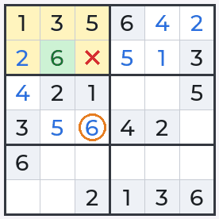

<!-- Written by tools/walkthrough.py mini-6x6: edit the script, not this page. -->
# Mini 6x6, step 9: the 6 in box 1

**Step 9 of 20** · [← Step 8](step-08.md) · [All steps](../mini-6x6.md#the-whole-puzzle-step-by-step) · [Step 10 →](step-10.md)

Box 1 needs a 6. r2c3: column 3 has one (r4c3). Only **r2c2** is left: **r2c2 = 6**.

**Step 9 of 20** · [← Step 8](step-08.md) · [All steps](../mini-6x6.md#the-whole-puzzle-step-by-step) · [Step 10 →](step-10.md)
