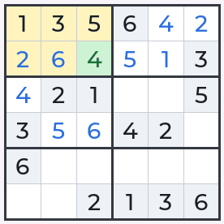

<!-- Written by tools/walkthrough.py mini-6x6: edit the script, not this page. -->
# Mini 6x6, step 10: the 4 in box 1

**Step 10 of 20** · [← Step 9](step-09.md) · [All steps](../mini-6x6.md#the-whole-puzzle-step-by-step) · [Step 11 →](step-11.md)

Box 1 needs a 4, and r2c3 is its last empty cell: **r2c3 = 4**.

**Step 10 of 20** · [← Step 9](step-09.md) · [All steps](../mini-6x6.md#the-whole-puzzle-step-by-step) · [Step 11 →](step-11.md)
