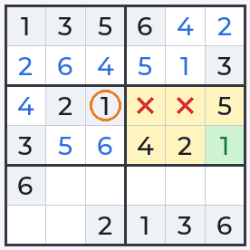

<!-- Written by tools/walkthrough.py mini-6x6: edit the script, not this page. -->
# Mini 6x6, step 11: the 1 in box 4

**Step 11 of 20** · [← Step 10](step-10.md) · [All steps](../mini-6x6.md#the-whole-puzzle-step-by-step) · [Step 12 →](step-12.md)

Box 4 needs a 1. r3c4 and r3c5: row 3 has one (r3c3). Only **r4c6** is left: **r4c6 = 1**.

**Step 11 of 20** · [← Step 10](step-10.md) · [All steps](../mini-6x6.md#the-whole-puzzle-step-by-step) · [Step 12 →](step-12.md)
