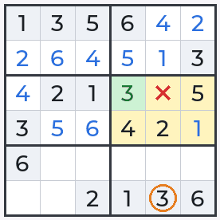

<!-- Written by tools/walkthrough.py mini-6x6: edit the script, not this page. -->
# Mini 6x6, step 12: the 3 in box 4

**Step 12 of 20** · [← Step 11](step-11.md) · [All steps](../mini-6x6.md#the-whole-puzzle-step-by-step) · [Step 13 →](step-13.md)

Box 4 needs a 3. r3c5: column 5 has one (r6c5). Only **r3c4** is left: **r3c4 = 3**.

**Step 12 of 20** · [← Step 11](step-11.md) · [All steps](../mini-6x6.md#the-whole-puzzle-step-by-step) · [Step 13 →](step-13.md)
