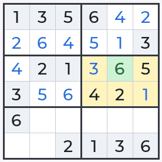

<!-- Written by tools/walkthrough.py mini-6x6: edit the script, not this page. -->
# Mini 6x6, step 13: the 6 in box 4

**Step 13 of 20** · [← Step 12](step-12.md) · [All steps](../mini-6x6.md#the-whole-puzzle-step-by-step) · [Step 14 →](step-14.md)

Box 4 needs a 6, and r3c5 is its last empty cell: **r3c5 = 6**.

**Step 13 of 20** · [← Step 12](step-12.md) · [All steps](../mini-6x6.md#the-whole-puzzle-step-by-step) · [Step 14 →](step-14.md)
