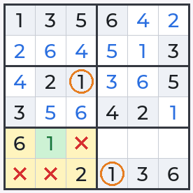

<!-- Written by tools/walkthrough.py mini-6x6: edit the script, not this page. -->
# Mini 6x6, step 14: the 1 in box 5

**Step 14 of 20** · [← Step 13](step-13.md) · [All steps](../mini-6x6.md#the-whole-puzzle-step-by-step) · [Step 15 →](step-15.md)

Box 5 needs a 1. r5c3: column 3 has one (r3c3). r6c1 and r6c2: row 6 has one (r6c4). Only **r5c2** is left: **r5c2 = 1**.

**Step 14 of 20** · [← Step 13](step-13.md) · [All steps](../mini-6x6.md#the-whole-puzzle-step-by-step) · [Step 15 →](step-15.md)
