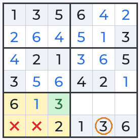

<!-- Written by tools/walkthrough.py mini-6x6: edit the script, not this page. -->
# Mini 6x6, step 15: the 3 in box 5

**Step 15 of 20** · [← Step 14](step-14.md) · [All steps](../mini-6x6.md#the-whole-puzzle-step-by-step) · [Step 16 →](step-16.md)

Box 5 needs a 3. r6c1 and r6c2: row 6 has one (r6c5). Only **r5c3** is left: **r5c3 = 3**.

**Step 15 of 20** · [← Step 14](step-14.md) · [All steps](../mini-6x6.md#the-whole-puzzle-step-by-step) · [Step 16 →](step-16.md)
