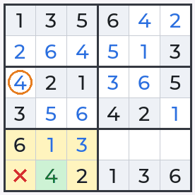

<!-- Written by tools/walkthrough.py mini-6x6: edit the script, not this page. -->
# Mini 6x6, step 16: the 4 in box 5

**Step 16 of 20** · [← Step 15](step-15.md) · [All steps](../mini-6x6.md#the-whole-puzzle-step-by-step) · [Step 17 →](step-17.md)

Box 5 needs a 4. r6c1: column 1 has one (r3c1). Only **r6c2** is left: **r6c2 = 4**.

**Step 16 of 20** · [← Step 15](step-15.md) · [All steps](../mini-6x6.md#the-whole-puzzle-step-by-step) · [Step 17 →](step-17.md)
