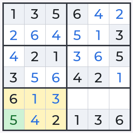

<!-- Written by tools/walkthrough.py mini-6x6: edit the script, not this page. -->
# Mini 6x6, step 17: the 5 in box 5

**Step 17 of 20** · [← Step 16](step-16.md) · [All steps](../mini-6x6.md#the-whole-puzzle-step-by-step) · [Step 18 →](step-18.md)

Box 5 needs a 5, and r6c1 is its last empty cell: **r6c1 = 5**.

**Step 17 of 20** · [← Step 16](step-16.md) · [All steps](../mini-6x6.md#the-whole-puzzle-step-by-step) · [Step 18 →](step-18.md)
