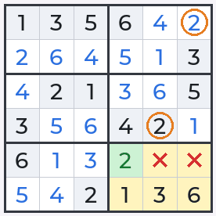

<!-- Written by tools/walkthrough.py mini-6x6: edit the script, not this page. -->
# Mini 6x6, step 18: the 2 in box 6

**Step 18 of 20** · [← Step 17](step-17.md) · [All steps](../mini-6x6.md#the-whole-puzzle-step-by-step) · [Step 19 →](step-19.md)

Box 6 needs a 2. r5c5: column 5 has one (r4c5). r5c6: column 6 has one (r1c6). Only **r5c4** is left: **r5c4 = 2**.

**Step 18 of 20** · [← Step 17](step-17.md) · [All steps](../mini-6x6.md#the-whole-puzzle-step-by-step) · [Step 19 →](step-19.md)
