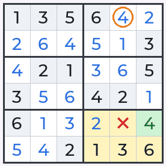

<!-- Written by tools/walkthrough.py mini-6x6: edit the script, not this page. -->
# Mini 6x6, step 19: the 4 in box 6

**Step 19 of 20** · [← Step 18](step-18.md) · [All steps](../mini-6x6.md#the-whole-puzzle-step-by-step) · [Step 20 →](step-20.md)

Box 6 needs a 4. r5c5: column 5 has one (r1c5). Only **r5c6** is left: **r5c6 = 4**.

**Step 19 of 20** · [← Step 18](step-18.md) · [All steps](../mini-6x6.md#the-whole-puzzle-step-by-step) · [Step 20 →](step-20.md)
