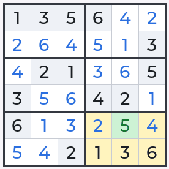

<!-- Written by tools/walkthrough.py mini-6x6: edit the script, not this page. -->
# Mini 6x6, step 20: the 5 in box 6

**Step 20 of 20** · [← Step 19](step-19.md) · [All steps](../mini-6x6.md#the-whole-puzzle-step-by-step) · [All steps](../mini-6x6.md#the-whole-puzzle-step-by-step)

Box 6 needs a 5, and r5c5 is its last empty cell: **r5c5 = 5**.

Solved.

**Step 20 of 20** · [← Step 19](step-19.md) · [All steps](../mini-6x6.md#the-whole-puzzle-step-by-step) · [All steps](../mini-6x6.md#the-whole-puzzle-step-by-step)
