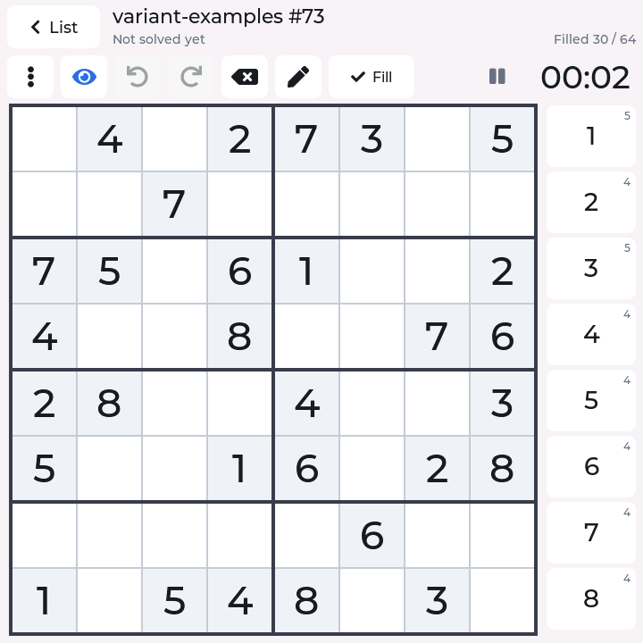
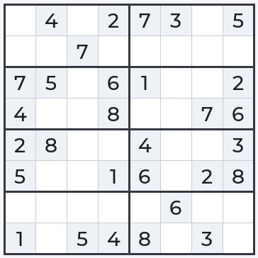

# Mini 8×8

[← All variants](README.md) · [Puzzles](../features-puzzles.md) · [How to play](../how-to-play.md)

## The rules

An 8×8 grid with the digits 1 to 8: every **row**, every **column** and every **box** holds 1 to 8, each once. The boxes are **2 rows tall and 4 columns wide**, so there are eight of them: two side by side, four down.

## On the board

- An eight-key number pad; everything else works as in [Classic](classic.md).
- **Puzzles → ⋮ → New puzzle → Grids → Mini 8x8**, at all four levels. Easy keeps 28 or more of the 64 cells.
- Between Mini 6×6 and Classic in size: a game takes a little less than a Classic one.

## How to solve it

- The same steps as Classic: look for **hidden singles** in each box and line first.
- Mind the box shape: a box spans 4 columns but only 2 rows. A digit in a row rules out a whole row of a box, half of it; a digit in a column only one cell of the box's two in that column.
- Each pair of rows holds two boxes side by side: once a digit is in one of the two rows, the other row has it in the other box.

## Worked example

**variant-examples #73**, Mini 8×8 Easy (see [Classic](classic.md#worked-example-the-whole-puzzle) for how to import the examples; cells are written r*row*c*column*).

**Step 1: the 5 in box 1 (rows 1–2, columns 1–4).** r1c2 and r1c4 hold 4 and 2, r2c3 holds 7. Row 1 has a 5 (r1c8), which rules out r1c1 and r1c3; column 1 has one (r6c1) and column 2 one (r3c2), which rule out r2c1 and r2c2. **r2c4 = 5**.

**Step 2: the 3 in box 4 (rows 3–4, columns 5–8).** r3c5, r3c8, r4c7 and r4c8 are filled. Column 6 has a 3 (r1c6), which rules out r3c6 and r4c6; column 7 has one (r8c7), which rules out r3c7. **r4c5 = 3**.

**Step 3: the 3 in box 3 (rows 3–4, columns 1–4).** Five of its cells are filled (7, 5, 6 in row 3; 4, 8 in row 4); row 4 now has its 3 (r4c5, step 2), which rules out r4c2 and r4c3. **r3c3 = 3**.

## The whole puzzle, step by step

<!-- walkthrough -->
<!-- Written by tools/walkthrough.py mini-8x8: edit the script, not this part. -->

The whole puzzle, from the start to the last cell: 34 steps, each one a single (one place left for a digit, or one digit left for a cell), taken in the order a box's single comes first, so not quite the order of the worked example above. Each step has a page of its own, with **Previous** and **Next**: pick its number below. In each picture, the unit the step looks at is tinted yellow (for a cell with one digit left: its row, column and box), the new digit is on green, the digits that rule cells out have an **orange ring**, and the empty cells they rule out a **red cross**. Givens are on grey, digits from earlier steps in blue.

| [1](mini-8x8/step-01.md) | [2](mini-8x8/step-02.md) | [3](mini-8x8/step-03.md) | [4](mini-8x8/step-04.md) | [5](mini-8x8/step-05.md) | [6](mini-8x8/step-06.md) | [7](mini-8x8/step-07.md) | [8](mini-8x8/step-08.md) | [9](mini-8x8/step-09.md) | [10](mini-8x8/step-10.md) |
|:-:|:-:|:-:|:-:|:-:|:-:|:-:|:-:|:-:|:-:|
| [11](mini-8x8/step-11.md) | [12](mini-8x8/step-12.md) | [13](mini-8x8/step-13.md) | [14](mini-8x8/step-14.md) | [15](mini-8x8/step-15.md) | [16](mini-8x8/step-16.md) | [17](mini-8x8/step-17.md) | [18](mini-8x8/step-18.md) | [19](mini-8x8/step-19.md) | [20](mini-8x8/step-20.md) |
| [21](mini-8x8/step-21.md) | [22](mini-8x8/step-22.md) | [23](mini-8x8/step-23.md) | [24](mini-8x8/step-24.md) | [25](mini-8x8/step-25.md) | [26](mini-8x8/step-26.md) | [27](mini-8x8/step-27.md) | [28](mini-8x8/step-28.md) | [29](mini-8x8/step-29.md) | [30](mini-8x8/step-30.md) |
| [31](mini-8x8/step-31.md) | [32](mini-8x8/step-32.md) | [33](mini-8x8/step-33.md) | [34](mini-8x8/step-34.md) |  |  |  |  |  |  |

Solved.

<!-- /walkthrough -->
